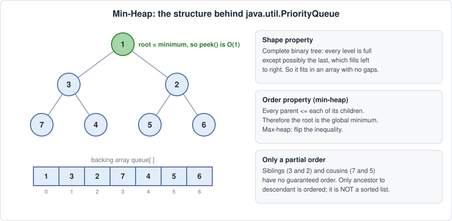
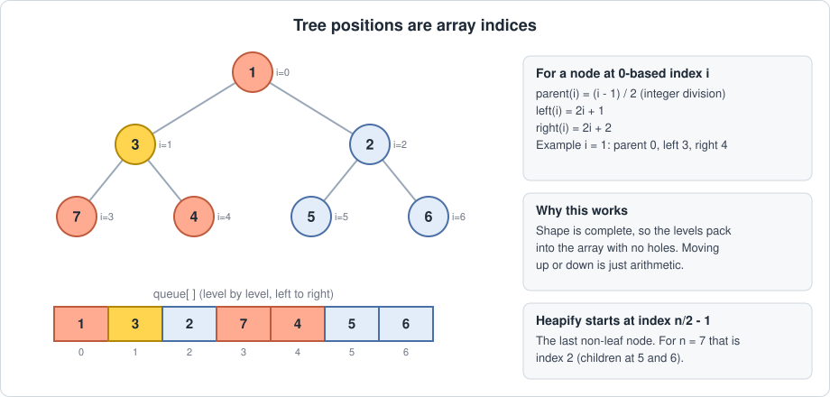
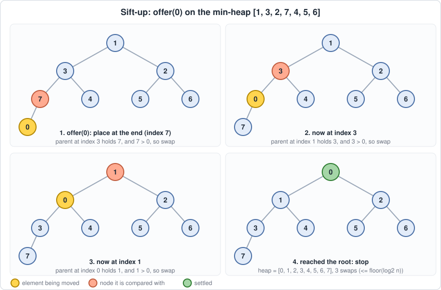
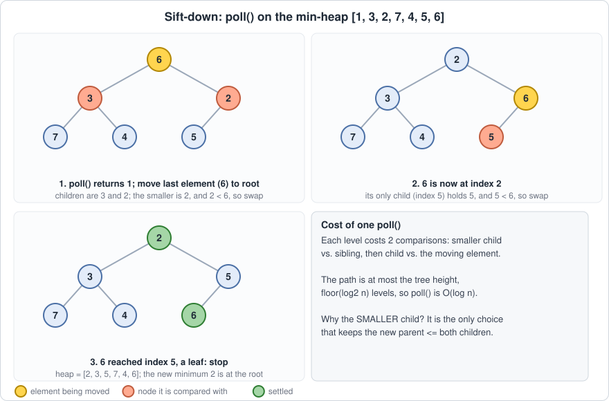

# Priority Queue in Java 🏔️

> "A queue where the next element out isn't the oldest one — it's the most important one."

This section covers the fundamental properties, memory mechanics, and basic operations of Priority Queues in Java, and the binary heap that powers them.

## 🧠 Core Properties
A priority queue is an **abstract data type (ADT)**: a collection where every element carries a priority, and the only element you can efficiently inspect or remove is the one with the **highest priority**. "Priority queue" describes *behaviour*; a **binary heap** is the usual *implementation*, and that is what Java uses.

<p align="center">
  <br>
  <em>Figure: A min-heap, its two invariants, and the array that backs it</em>
</p>

*   **Priority-Ordered Removal:** Elements leave in priority order, not insertion order. This is what separates it from a plain FIFO queue.
*   **Shape Property (Complete Binary Tree):** Every level is completely filled except possibly the last, which is filled left to right. This is what lets the whole tree live in a plain array with no gaps.
*   **Order Property (Heap Order):** In a **min-heap**, every parent is `<=` its children, so the root is always the global minimum. A max-heap flips the inequality.
*   **Only a Partial Order:** A heap is *not* a sorted structure. Only ancestor → descendant pairs are ordered. Siblings, and nodes in different subtrees, have no guaranteed relationship. That weaker guarantee is exactly why it is cheaper to maintain than a sorted list.
*   **Duplicates Allowed:** Equal priorities are fine, but their relative removal order is **not** defined (more on this below).

## ☕ Java-Specific Behaviors
*   **Class and Backing Store:** `java.util.PriorityQueue<E>` implements `Queue<E>` and is backed internally by an `Object[]` that holds the heap. The queue variable is a reference on the Stack; the heap array and the element objects live on the Heap.
*   **Min-Heap by Default:** With no comparator, the *smallest* element by natural ordering comes out first. For a max-heap you must supply a comparator, e.g. `new PriorityQueue<>(Collections.reverseOrder())` or `(a, b) -> Integer.compare(b, a)`.
*   **Ordering Rules:** Elements must either implement `Comparable`, or you pass a `Comparator` to the constructor. Otherwise the first comparison throws `ClassCastException`.
*   **Prefer `Integer.compare` over Subtraction:** A comparator like `(a, b) -> b - a` silently overflows for large or mixed-sign values and gives a wrong ordering. `Integer.compare(b, a)` (or `Long.compare`) is always safe.
*   **Multi-Key Ordering:** To order by several keys, chain comparisons: compare the first key, and only if they tie, compare the next. This is how you encode rules like "smallest weight, then smallest index". Storing `int[]` or `long[]` tuples with such a comparator is a very common pattern.
*   **No `null` Elements:** `offer(null)` throws `NullPointerException`, because `null` cannot be compared.
*   **Unbounded, Auto-Growing:** The default initial capacity is 11. When full, the array grows (roughly doubling while small, then by about 50%), so a single insert can occasionally cost O(n) for the copy.
*   **Not Stable:** Elements with equal priority do **not** come out in insertion order. If you need FIFO among ties, add an explicit tie-breaker such as an insertion counter or an index.
*   **Iteration Is Not Sorted:** `toString()`, enhanced `for`, and iterators walk the *internal array*, which only satisfies heap order. The only correct way to get sorted output is to `poll()` repeatedly.
*   **Mutating Keys Breaks the Heap:** If an element's priority-relevant fields change *after* insertion, the heap does not notice and silently stops being a valid heap. Java has no `decreaseKey`. The standard workaround is to insert a fresh entry (and ignore the stale one later), or remove and re-insert.
*   **Method Pairs:** `add` / `offer` insert (same behaviour here since the queue is unbounded). `remove()` / `element()` throw `NoSuchElementException` on an empty queue, while `poll()` / `peek()` return `null`. Remember that `int x = pq.poll();` on an empty `PriorityQueue<Integer>` throws `NullPointerException` while unboxing.
*   **Not Thread-Safe:** For concurrent use, look at `PriorityBlockingQueue`.

## ⚙️ The Magic of Index Math
Why does a heap need no node objects and no pointers? Because of the shape property. A complete tree can be stored level by level in an array, and parent/child relationships become pure arithmetic.

<p align="center">
  <br>
  <em>Figure: Tree positions map directly onto array indices</em>
</p>

For a node at 0-based index `i`:

*   `parent(i) = (i - 1) / 2` (integer division)
*   `left(i) = 2i + 1`
*   `right(i) = 2i + 2`

Moving between a node and its parent or child is a couple of arithmetic operations, with no loops and no pointer chasing. The elements also sit contiguously in memory, so traversals are cache-friendly.

Because every level except the last is full, a heap with `n` elements has height `floor(log2 n)`. That height is the upper bound on how far any element ever travels during an insert or remove, which is where the **O(log n)** comes from.

`peek()` is **O(1)** for the same reason array indexing is: the minimum is always at `queue[0]`, so there is nothing to search.

## 🔁 How Insert and Remove Actually Work
Both operations temporarily break the heap order at one spot and then repair it along a single root-to-leaf path. That repair is what costs O(log n).

### Insert: Sift-Up
1.  Place the new element at the **end** of the array (the next free slot, so the shape property is preserved).
2.  While it has a parent and is **smaller** than that parent, swap them.
3.  Stop when the parent is `<=` it, or when it reaches the root.

<p align="center">
  <br>
  <em>Figure: offer(0) bubbling up from the last position to the root</em>
</p>

### Remove-Min: Sift-Down
1.  Save the root (this is the value to return).
2.  Move the **last** element of the array into the root slot and shrink the size (shape stays complete).
3.  While it has children, compare it with its **smaller** child. If the child is smaller, swap and continue; otherwise stop.

Choosing the *smaller* child matters: it is the only choice that keeps the new parent `<=` both of its children after the swap.

<p align="center">
  <br>
  <em>Figure: poll() sinking the displaced last element back into place</em>
</p>

### A Minimal Min-Heap in Java
This mirrors what `PriorityQueue` does internally (the JDK also moves the element by shifting parents/children rather than doing full swaps).

```java
import java.util.*;

class MinHeap {
    private int[] a = new int[11];
    private int size = 0;

    public void offer(int x) {
        if (size == a.length) a = Arrays.copyOf(a, size * 2);
        a[size] = x;
        siftUp(size++);
    }

    public int peek() {
        if (size == 0) throw new NoSuchElementException();
        return a[0];
    }

    public int poll() {
        if (size == 0) throw new NoSuchElementException();
        int root = a[0];
        a[0] = a[--size];
        if (size > 0) siftDown(0);
        return root;
    }

    private void siftUp(int i) {
        int x = a[i];
        while (i > 0) {
            int p = (i - 1) >>> 1;
            if (a[p] <= x) break;
            a[i] = a[p];          // pull the parent down
            i = p;
        }
        a[i] = x;
    }

    private void siftDown(int i) {
        int x = a[i];
        int half = size >>> 1;    // indices >= half are leaves
        while (i < half) {
            int c = 2 * i + 1;    // left child
            if (c + 1 < size && a[c + 1] < a[c]) c++;   // pick the smaller child
            if (x <= a[c]) break;
            a[i] = a[c];          // pull the child up
            i = c;
        }
        a[i] = x;
    }
}
```

### Heapify: Building a Heap in O(n)
Inserting `n` elements one by one costs O(n log n). But if you already have all `n` elements in an array, you can do better: call sift-down on every non-leaf node, from the last one back to the root. The last non-leaf is at index `n/2 - 1`.

The surprising result is that this is **O(n)**, not O(n log n). The reason is that most nodes are near the bottom, where sifting is cheap. Roughly `n/2` nodes are leaves (cost 0), `n/4` nodes can sink at most 1 level, `n/8` at most 2, and so on. The total work is bounded by the sum of `h * n / 2^(h+1)` over all heights `h`, and that series converges to at most `n`.

In Java, `new PriorityQueue<>(collection)` uses this heapify when the source is not already sorted or a heap, while calling `addAll` performs `n` separate inserts.

## 🏗️ Basic Operations & Complexity

| Operation | Java Method | Description | Time Complexity |
| :--- | :--- | :--- | :--- |
| **Peek** | `peek()` / `element()` | Read the top-priority element without removing it. | O(1) |
| **Insert** | `offer()` / `add()` | Append at the end, then sift-up. | O(log n) worst case, O(1) on average for random input |
| **Remove top** | `poll()` / `remove()` | Take the root, move the last element up, then sift-down. | O(log n) |
| **Size / Empty check** | `size()` / `isEmpty()` | Stored as a field. | O(1) |
| **Search by value** | `contains(o)` | The heap has no search order, so every slot may need checking. | O(n) |
| **Remove arbitrary element** | `remove(o)` | O(n) to find it, then O(log n) to repair the heap. | O(n) |
| **Update a priority** | none | Remove and re-insert, or insert a new entry and ignore the stale one later. | O(n), or O(log n) with lazy deletion |
| **Build from `n` elements** | `new PriorityQueue<>(coll)` | Heapify. | O(n) |
| **Add `n` elements one by one** | `offer()` in a loop | `n` sift-ups. | O(n log n) |
| **Traversal** | iterator / `for` | Visits every element in internal (unsorted) order. | O(n) |

*Note: Full sorted output via repeated `poll()` costs O(n log n). That is exactly heap sort.*

## 🆚 Priority Queue vs. Other Structures

| Structure | Find-Min | Insert | Remove-Min | Remove Arbitrary | Notes |
| :--- | :--- | :--- | :--- | :--- | :--- |
| **Unsorted array / list** | O(n) | O(1) | O(n) | O(n) | Cheap writes, expensive reads |
| **Sorted array** (descending) | O(1) | O(n) | O(1) | O(n) | Cheap reads, expensive writes (shifting) |
| **Binary heap (`PriorityQueue`)** | O(1) | O(log n) | O(log n) | O(n) | Balanced: only the min is cheap to reach |
| **`TreeSet` / `TreeMap`** (balanced BST) | O(log n) | O(log n) | O(log n) | O(log n) | Fully ordered and supports arbitrary removal, but uses per-node objects and treats comparator-equal elements as duplicates |

The heap wins when you only ever need the extreme element: it gives up full ordering to keep insert and remove-min cheap, with a small constant factor and a compact array. If you also need ordered iteration, range queries, or fast arbitrary removal, a balanced tree is the better tool.

## 🪤 Common Gotchas
*   **Comparator overflow:** `(a, b) -> b - a` breaks on large values. Use `Integer.compare` / `Long.compare`.
*   **Equal priorities are unordered:** Add an explicit tie-breaker if the order among equals matters.
*   **Don't trust iteration order:** Printing a `PriorityQueue` shows the array, not the sorted order.
*   **Don't mutate keys in place:** Re-insert instead.
*   **Wrong direction by default:** Java's default is a *min*-heap; people regularly assume max.
*   **Sum and time values grow fast:** When priorities are accumulated times or sums, use `long` to avoid overflow.

---

## 🧩 Common Problem Patterns

*I will be exploring these in detail with brute-force to optimized solutions in the problem files, but here are the mental models for the core priority queue patterns:*

*   **Top-K Elements (Fixed-Size Heap):** A bouncer with a short guest list. To keep the K largest, hold them in a *min*-heap of size K; the weakest current member sits at the door, and a newcomer must beat them to get in.
*   **K-Way Merge:** K sorted lines of people; the heap holds the front person of each line, and whoever is smallest steps out next, revealing the next person behind them.
*   **Two Heaps (Running Median):** Split the data into a lower half (max-heap) and an upper half (min-heap). The two roots sit on either side of the median.
*   **Event Simulation / Scheduling (Free + Busy Heaps):** One heap picks who is *available and best*, another tells you who becomes *free next*. The clock jumps from event to event instead of ticking second by second (e.g. LC 1882, Process Tasks Using Servers).
*   **Greedy Graph Algorithms (Dijkstra, Prim):** Always expand the cheapest frontier node. Since there is no `decreaseKey`, push updated entries and skip stale ones when they come out (lazy deletion).
*   **Greedy Merging and Interval Problems:** Repeatedly take the smallest or earliest item, as in Huffman coding, meeting-room problems, and task schedulers.
